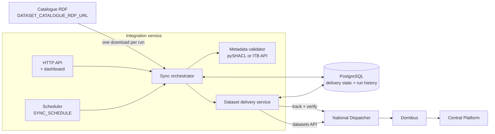
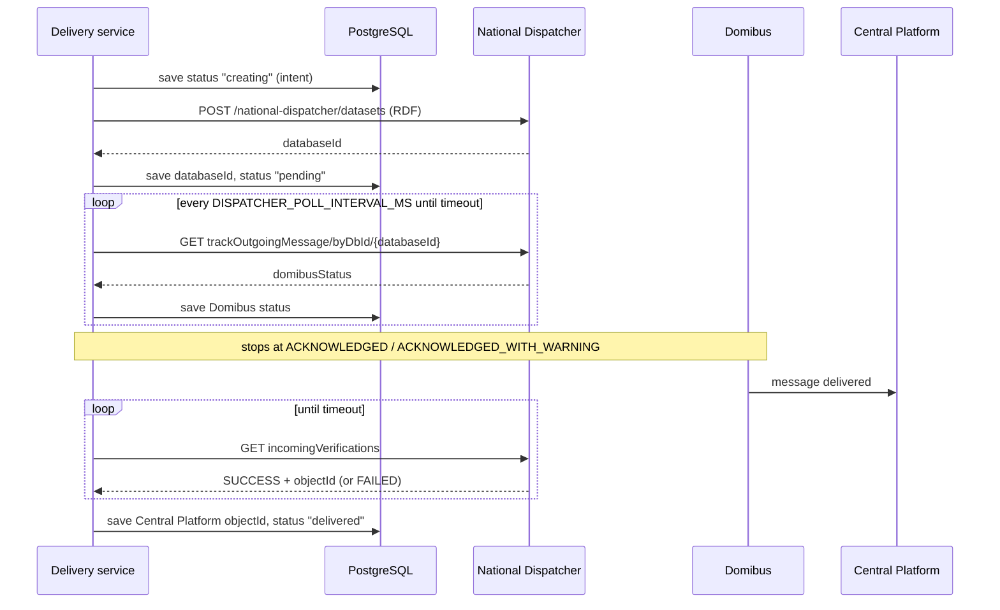

<!-- SPDX-FileCopyrightText: 2026 PNED G.I.E. -->
<!-- SPDX-License-Identifier: CC-BY-4.0 -->

# How the service works

The National Dispatcher Integration Service sits between a single metadata
source, the catalogue RDF configured with `DATASET_CATALOGUE_RDF_URL`, and the
existing National Dispatcher. It submits **dataset metadata only**: it never transfers dataset
files and does not replace dispatcher or Central Platform behaviour.

Its job is to turn "here is the current RDF for each dataset" into the right
create, update or delete call on the dispatcher, follow each message through
Domibus to the Central Platform, and keep a durable record of what was sent so
that nothing is sent twice and nothing is lost on a crash or timeout.

For every setting mentioned here, see [CONFIGURATION.md](CONFIGURATION.md).

## The big picture

Metadata enters the service only through **catalogue synchronization**. The
service downloads the whole catalogue, works out which datasets are new, changed
or removed, and delivers the differences. A run is started by the scheduler or
by `POST /api/v1/sync`. There is no endpoint for pushing a single dataset's RDF.

## Main components

| Component              | Code                                                                                            | Responsibility                                                                         |
| ---------------------- | ----------------------------------------------------------------------------------------------- | -------------------------------------------------------------------------------------- |
| Startup                | [src/server.ts](../src/server.ts)                                                               | Loads config, connects to PostgreSQL, applies migrations, starts the HTTP server.      |
| Wiring                 | [src/app.ts](../src/app.ts)                                                                     | Builds the Fastify app, checks validator config, registers routes and the scheduler.   |
| Config                 | [src/config/config.ts](../src/config/config.ts)                                                 | Reads and validates environment variables; startup fails on invalid values.            |
| Scheduler              | [src/scheduler/sync-scheduler.ts](../src/scheduler/sync-scheduler.ts)                           | Checks the cron expression every second and starts a run on a matching minute.         |
| Orchestrator           | [src/application/sync-orchestrator.ts](../src/application/sync-orchestrator.ts)                 | Runs one sync: fetch catalogue, validate, deliver, delete, record the run.             |
| Catalogue client       | [src/catalogue/](../src/catalogue/)                                                             | Downloads the catalogue RDF and extracts each `dcat:Dataset` with its linked metadata. |
| Validator              | [src/validation/](../src/validation/)                                                           | Checks metadata against SHACL rules, either locally (pySHACL) or via the ITB API.      |
| Delivery service       | [src/application/dataset-delivery-service.ts](../src/application/dataset-delivery-service.ts)   | Create/update/delete one dataset safely, including resume after a crash or timeout.    |
| Dispatcher client      | [src/dispatcher/national-dispatcher-client.ts](../src/dispatcher/national-dispatcher-client.ts) | HTTP calls to the National Dispatcher: submit, track Domibus status, verify.           |
| Persistence            | [src/persistence/postgres/](../src/persistence/postgres/)                                       | Delivery state per dataset, sync run history, advisory locks, migrations.              |
| HTTP API and dashboard | [src/api/](../src/api/)                                                                         | Control endpoints (token protected), status/monitoring endpoints, read-only dashboard. |

## What happens during a sync run

1. **Trigger.** The scheduler or `POST /api/v1/sync` asks the orchestrator to
   start a run. Only one run can be active: a second request gets HTTP 409, and
   a scheduled tick that overlaps a running sync is skipped.
2. **Resolve settings.** The run's operation mode and validator come from the
   request body if given, otherwise from configuration. The resolved settings
   are stored with the run so the history stays accurate if config changes later.
3. **Record the run.** A row is created in `sync_runs` and the API returns
   `202 Accepted` with the run ID. The rest happens in the background.
4. **Take the cluster-wide lock.** The run takes a PostgreSQL advisory lock, so
   if several instances share a database only one of them synchronizes at a time.
5. **Download the catalogue.** The full catalogue RDF is fetched once. Each
   `dcat:Dataset` is extracted with its linked metadata (distributions,
   publishers, contact points). The full dataset URI is its identity. A
   catalogue with no `dcat:Catalog`, a paginated catalogue, or a dataset without
   embedded metadata is rejected, so a partial catalogue can never cause mass
   deletions.
6. **Process each dataset**, one at a time, depending on the operation mode:
   - `validate_only`: validate and store the report. Nothing is sent.
   - `validate_and_sync`: validate first; a dataset with a `Violation` (or a
     validator error) is skipped and counted as failed. Otherwise deliver it.
   - `sync_only` (default): deliver without validating.
7. **Deliver** (see the next section). If the RDF's SHA-256 checksum matches
   the last delivered version, the dataset is skipped.
8. **Delete removed datasets.** On a full run (not a single-dataset run),
   any dataset the service delivered before that is no longer in the catalogue
   is deleted from the dispatcher.
9. **Finish.** Counters (`seen`, `created`, `updated`, `skipped`, `deleted`,
   `failed`, `inFlight`) and per-dataset reports are saved to the run.
   `completed` means processing finished; individual datasets can still have
   failed. `failed` means the run itself could not finish (for example the
   catalogue could not be downloaded).

## Delivering one dataset

All delivery goes through the delivery service and is protected by a
per-dataset PostgreSQL lock, so two operations can never work on the same
dataset at the same time.

The three operations:

- **Create**: when the dataset has no Central Platform object ID yet.
- **Update**: when it already has one. The dispatcher may confirm an update
  immediately (no `databaseId` returned), or the update is tracked like a create.
- **Delete**: uses the stored Central Platform object ID. A dispatcher 404
  means "already gone". The local row is removed only after a verified delete
  or a 404.

### Why the state is written before each call

Each step is saved to PostgreSQL _before_ the next external call. This is
what makes the service safe to restart at any point:

- **Intent before create.** `creating` is saved before calling the
  dispatcher. If the call times out or the network fails, the dataset becomes
  `uncertain`: the dispatcher may or may not have accepted it, and there is no
  ID to check. The service will **not** create it again automatically; an
  operator must reconcile it. This prevents duplicate datasets on the Central
  Platform.
- **Resume instead of resend.** Once a `databaseId` is saved, later attempts
  resume tracking that same message instead of submitting a new one.
- **Skip unchanged data.** A dataset is skipped only when its checksum matches
  _and_ its status is `delivered`.

### Domibus statuses and what the service does

| Domibus status                                                              | Meaning for the service                                                            |
| --------------------------------------------------------------------------- | ---------------------------------------------------------------------------------- |
| `READY_TO_SEND`, `SEND_ENQUEUED`, `SEND_IN_PROGRESS`, `WAITING_FOR_RECEIPT` | In flight. Keep polling.                                                           |
| `SEND_ATTEMPT_FAILED`, `WAITING_FOR_RETRY`                                  | In flight. Domibus retries by itself; the service keeps polling and never resends. |
| `ACKNOWLEDGED`, `ACKNOWLEDGED_WITH_WARNING`                                 | Received. Move on to Central Platform verification.                                |
| `SEND_FAILURE`, `NOT_FOUND`, `DELETED`                                      | Terminal. Counted as failed; the next attempt submits a fresh message.             |

If tracking reaches `DISPATCHER_VERIFICATION_TIMEOUT_MS` while the message is
still in flight, the dataset is **not** marked failed. It keeps its Domibus
status (or `pending`), is counted under `datasetsInFlight`, and the next run
picks up tracking where it stopped.

The dispatcher can also reject the RDF itself (its own validation, which is
disabled with `disableValidation=true` when `OPERATION_MODE=sync_only`). That
rejection is a normal failure with the dispatcher's error details.

### Local delivery statuses

| Status                             | Meaning                                                                              |
| ---------------------------------- | ------------------------------------------------------------------------------------ |
| `creating`, `updating`, `deleting` | A request is about to be, or is being, sent.                                         |
| `pending`                          | The dispatcher accepted the message; Domibus has not reported a status yet.          |
| Domibus statuses                   | Last status observed while tracking (see table above).                               |
| `delivered`                        | Verified on the Central Platform.                                                    |
| `failed`                           | The last attempt failed; it will be retried on the next run.                         |
| `uncertain`                        | A create or delete may have been accepted but no ID was received. Needs an operator. |

## Validation

Validation checks dataset metadata against SHACL rules before (or instead of)
delivery. It is controlled by two independent settings:

- `OPERATION_MODE` decides **whether** to validate: `validate_only`,
  `validate_and_sync`, or `sync_only`.
- `VALIDATION_MODE` decides **where**: `shacl` runs the bundled pySHACL worker
  as a local Python process; `itb` calls an external ITB validator such as the
  HealthData@EU API.

Severity policy: a dataset passes when its findings contain only `Warning` or
`Info`. Any `Violation`, unknown severity, parser error or validator failure
fails it. A remote validator failure never falls back to local validation.

Each report stores the checksum of the RDF it checked. The dashboard shows a
Release 8 pass/fail only when that checksum matches the delivered RDF and the
report's profile matches `RELEASE8_VALIDATION_PROFILE`. Otherwise it shows
"not assessed" or "outdated". Delivery success never implies compliance.

## HTTP API

| Method and path                          | Auth  | Purpose                                                                                                 |
| ---------------------------------------- | ----- | ------------------------------------------------------------------------------------------------------- |
| `GET /`                                  | none  | Read-only dashboard (refreshes every 5 seconds).                                                        |
| `GET /health`                            | none  | Liveness: the process is up.                                                                            |
| `GET /ready`                             | none  | Readiness: PostgreSQL is reachable (503 otherwise).                                                     |
| `GET /api/v1/monitoring`                 | none  | Data behind the dashboard: grouped counts, sync health, the attention list, deliveries and run history. |
| `POST /api/v1/sync`                      | token | Start a full catalogue sync. Optional JSON body for per-run options.                                    |
| `POST /api/v1/sync/dataset/:datasetId`   | token | Sync one dataset from the catalogue. No deletions.                                                      |
| `GET /api/v1/sync/:runId`                | none  | Run status, counters, reports and settings.                                                             |
| `GET /api/v1/datasets/:datasetId/status` | none  | Delivery state of one catalogue dataset (URL-encoded dataset URI). 404 if none is recorded.             |

"Token" means `Authorization: Bearer <CONTROL_API_TOKEN>`. Every non-GET
request needs it. If no token is configured, those requests return 503; a
wrong or missing token returns 401. GET endpoints are open, so put the service
behind your normal access boundary if status data should be private.

Common error responses: 400 invalid request or run options, 409 a sync is
already running, 503 controls disabled or validator unavailable.

Request and response examples are in the [README](../README.md#api).

## Data stored in PostgreSQL

All tables live in the schema named by `POSTGRES_SCHEMA`. Migrations in
[src/persistence/postgres/migrations/](../src/persistence/postgres/migrations/)
are applied at startup and recorded in `schema_migrations`. The whole schema is
in `001_initial_schema.sql`; later schema changes go in new numbered files.

- **`dataset_delivery_sync`**: one row per catalogue dataset. Holds the
  checksum, dispatcher `databaseId`, Domibus message ID, Central Platform
  object ID, current status, retry count, last error and timestamps.
  Rows are stored under the source `catalogue`.
- **`sync_runs`**: one row per run with mode, status, counters, resolved
  settings and per-dataset reports (validation findings, errors, in-flight notes).

## Concurrency guarantees

- One run at a time per process (in-memory flag) and per database (advisory lock
  `catalogue-dataset-sync`).
- One operation at a time per dataset (per-dataset advisory lock).
- Datasets are processed sequentially. A run with many stuck messages can take
  roughly _number of stuck datasets × `DISPATCHER_VERIFICATION_TIMEOUT_MS`_;
  keep that below the `SYNC_SCHEDULE` interval or the next scheduled run is
  skipped.
